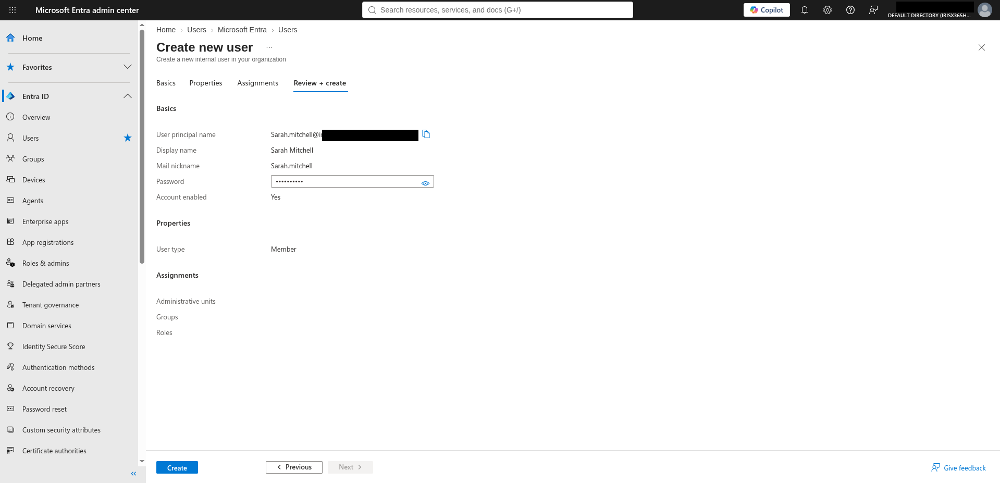
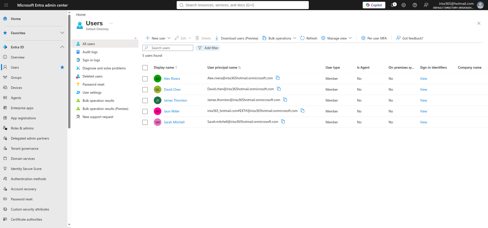
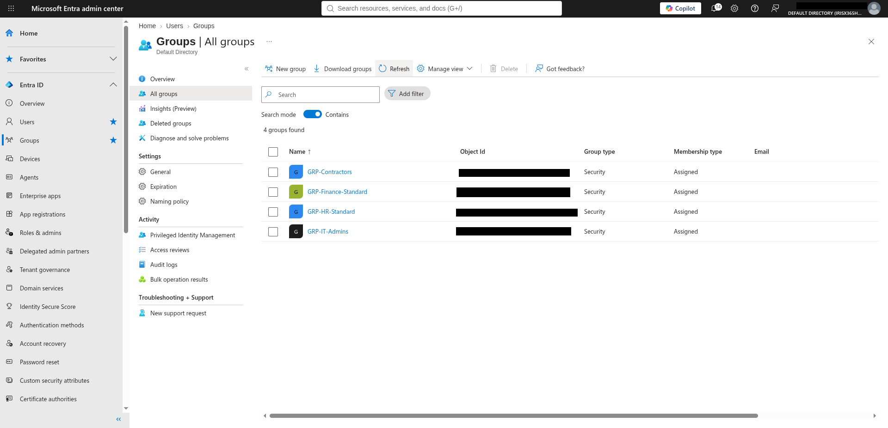
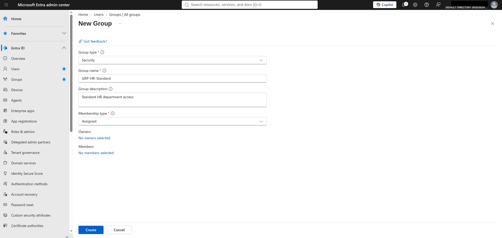
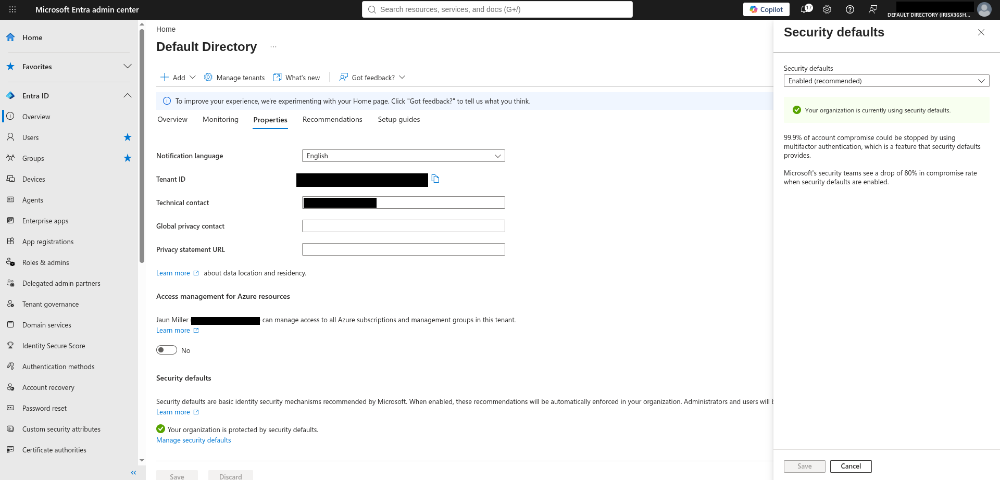
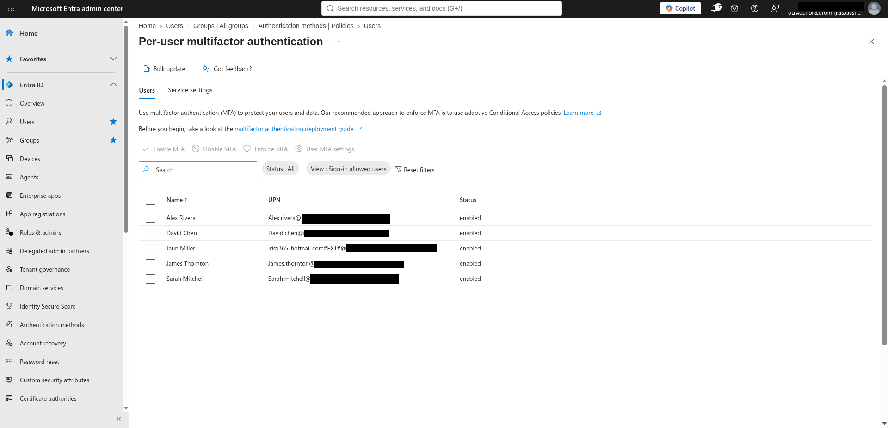

# SecureLogix IAM Zero Trust Lab

## Objective

This lab simulates an identity lifecycle management environment using Microsoft Entra ID, following the Joiner-Mover-Leaver (JML) framework. The goal was to provision and manage user identities, assign role-based access control (RBAC), and enforce Zero Trust principles — documented using GRC methodology to demonstrate compliance-aligned identity governance.

### Skills Learned

- Identity lifecycle management using the Joiner-Mover-Leaver (JML) framework
- User provisioning and de-provisioning in Microsoft Entra ID
- Role-Based Access Control (RBAC) assignment and principle of least privilege
- Group-based access management and policy scoping
- Multi-Factor Authentication (MFA) enforcement as a Zero Trust control
- GRC documentation of identity and access management controls

### Tools Used

- Microsoft Entra ID (Azure Active Directory) — identity provisioning, RBAC, MFA
- Microsoft Entra Admin Center — user and group management interface

## Steps

### User Provisioning — Joiner Workflow

*Step 1: Create new user (Sarah Mitchell)*

New user Sarah Mitchell provisioned in Microsoft Entra ID. The Review + create screen confirms the User Principal Name (UPN), display name, account status set to enabled, and user type set to Member — consistent with a standard Joiner workflow onboarding a new employee.

*Step 2: Users list — provisioned identities*

Entra ID users list confirming five active identities: Alex Rivera, David Chen, James Thornton, Jaun Miller, and Sarah Mitchell. This view demonstrates the current identity inventory managed within the SecureLogix tenant.

### Group Management — Access Scoping

*Step 3: Security groups inventory*

Four security groups created to enforce role-based access scoping: GRP-Contractors, GRP-Finance-Standard, GRP-HR-Standard, and GRP-IT-Admins. All groups are Security type with Assigned membership, following the principle of least privilege — each group grants access only to resources appropriate for that department or role.

*Step 4: Create new group (GRP-HR-Standard)*

New security group GRP-HR-Standard created with group type set to Security, membership type set to Assigned, and description set to "Standard HR department access." Assigned membership ensures access is explicitly granted rather than dynamically inherited, maintaining auditability aligned with NIST SP 800-53 AC-2 (Account Management).

### MFA Enforcement — Zero Trust Control

*Step 5: Security defaults enabled*

Security defaults enabled at the tenant level, enforcing baseline MFA requirements across all users. Microsoft's security defaults implement Zero Trust identity controls without requiring a premium licence — confirming the organisation is protected against credential-based attacks.

*Step 6: Per-user MFA status*

Per-user MFA status confirmed as enabled for all five identities in the SecureLogix tenant. MFA enforcement aligns with NIST SP 800-53 IA-5 (Authenticator Management) and supports Zero Trust principles by requiring verified identity before granting access to any resource.

## Findings Summary

| Control Area | Action Taken | Framework Reference |
|---|---|---|
| User Provisioning | New user onboarded via JML Joiner workflow | NIST SP 800-53 AC-2 |
| RBAC | Four security groups created with least privilege scoping | NIST SP 800-53 AC-6 |
| MFA | Security defaults enabled, per-user MFA confirmed for all identities | NIST SP 800-53 IA-5 |
